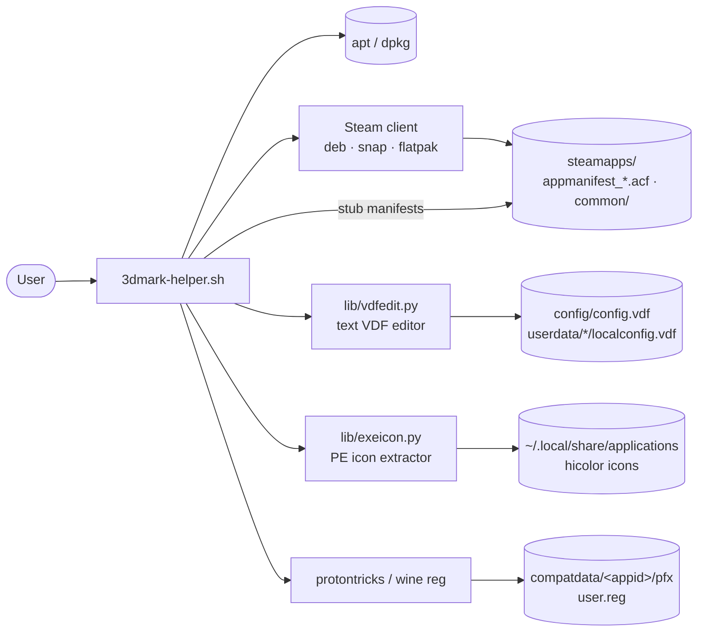
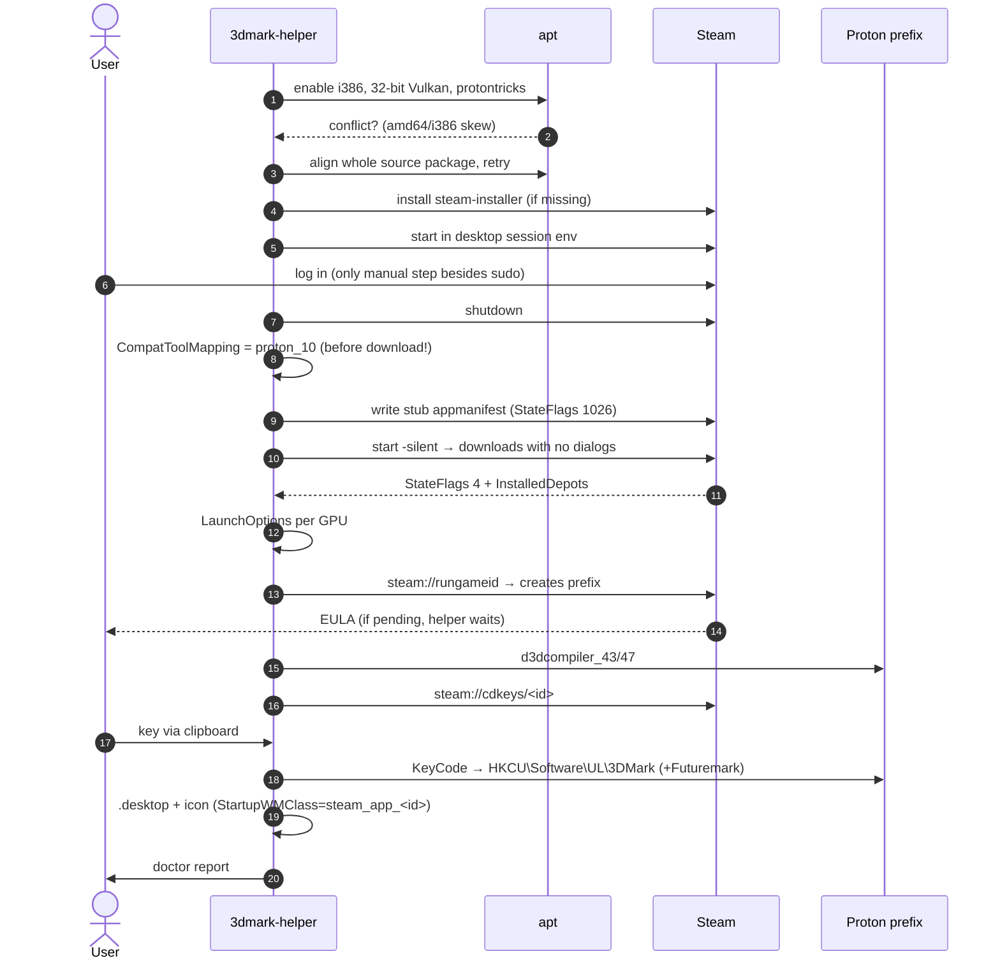
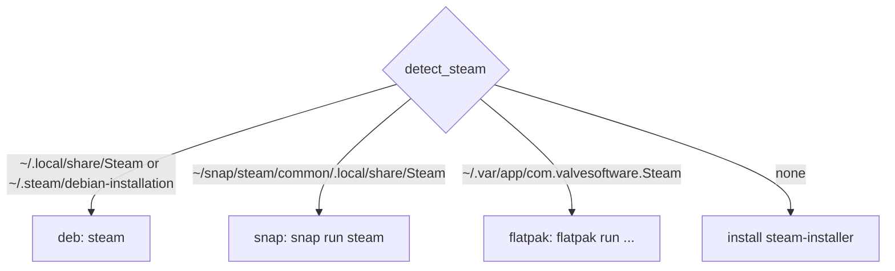
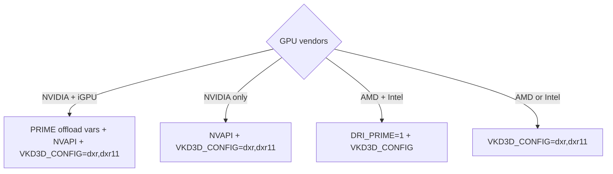

# Architecture

`linux-steam-3dmark-helper` is a single Bash entry point (`3dmark-helper.sh`) with two small, dependency-free Python helpers in `lib/`. It never ships or modifies 3DMark files: it prepares the system, drives the Steam client through its own mechanisms (`steam://` URLs, app manifests, config files), and configures the Proton prefix.

## Components

| Piece | Responsibility |
|---|---|
| `3dmark-helper.sh` | Command dispatch, detection (distro, desktop, GPU, Steam flavour), orchestration, user-facing output |
| `lib/vdfedit.py` | Parse/serialise Valve text-VDF; set `CompatToolMapping` and `LaunchOptions`; writes a one-time `.3dmark-helper.bak` |
| `lib/exeicon.py` | Walk a PE resource table, pull the largest icon → 256 px PNG for menu/taskbar |
| `tests/` | Bats tests for VDF editing, GPU launch-option logic, Proton selection |

## The `install` flow

## Key decisions

| Decision | Why |
|---|---|
| **Pin Proton 10, never auto-pick 11** | Proton 11 refuses every DX12 test ("You need a DirectX 12 compatible GPU", Proton#4034, May 2026). |
| **Map Proton before download** | Without a compat mapping Steam picks Linux depots for a Windows-only app and "installs" 0 depots. |
| **Stub manifests instead of `steam://install`** | No dialogs → no user input. Steam treats `StateFlags 1026` as "update required + started". |
| **"Installed" = StateFlags 4 *and* InstalledDepots** | Catches the empty-install case above. |
| **Edit VDF only with Steam closed** | Steam rewrites config on exit; edits made while running are lost. |
| **Align multiarch by source package** | An orphaned amd64 build (e.g. from a removed PPA) blocks every `:i386` package; downgrading one binary drags its siblings. |
| **Start Steam with the desktop session env** | From SSH/TTY Steam lacks D-Bus/XDG vars and its UI never shows a window. |
| **No title-bar hacks** | 3DMark is a borderless window by design; forcing decorations breaks rendering. Documented shortcuts instead. |
| **Pure-Python helpers, no pip deps** | Works on a fresh install (Pillow only for icons; optional). |

## Steam flavours

## GPU → launch options

## Desktop integration

Works on GNOME, XFCE, KDE Plasma and LXQt (X11 and Wayland): XDG `.desktop` + hicolor icon, cache refresh (`update-desktop-database`, `gtk-update-icon-cache`, `kbuildsycoca6/5`, `xdg-desktop-menu`), clipboard via `wl-paste` / `xclip` / `xsel` / Klipper.

## Files touched on the user's system

| Path | Change | Backup |
|---|---|---|
| `Steam/config/config.vdf` | `CompatToolMapping/<appid>` | `config.vdf.3dmark-helper.bak` |
| `Steam/userdata/*/config/localconfig.vdf` | `LaunchOptions` | `.3dmark-helper.bak` |
| `Steam/steamapps/appmanifest_<id>.acf` | stub (only if app missing) | — |
| `compatdata/<id>/pfx/user.reg` | `KeyCode`, d3dcompiler DLLs | — |
| `~/.local/share/applications/3dmark-helper-<id>.desktop` | new | — |
| `~/.local/share/icons/hicolor/256x256/apps/steam_icon_<id>.png` | new | — |
